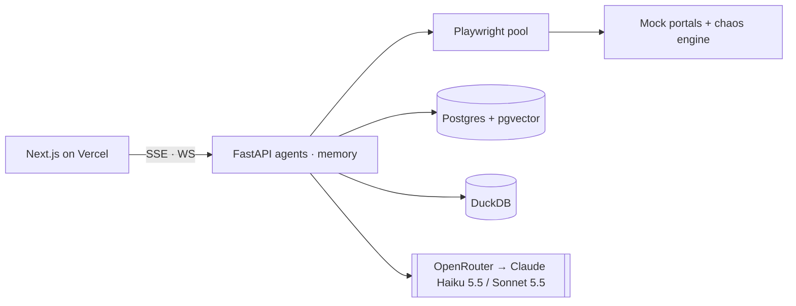

# Backroom

[](https://github.com/Vijay190899/backroom/actions/workflows/ci.yml)
[](LICENSE)
[](https://github.com/Vijay190899/backroom/commits/main)


**The engine under "Approve all".** Backroom is an agentic back office for a local café. It finds money in the business data, explains it with evidence, and carries out the fix in the owner's web tools: logging in, handling 2FA, clicking through. It gets faster, cheaper and more aligned with the owner every time it runs.

> Independent exploration built for a Founding Engineer interview with Super44. Not affiliated with or endorsed by Super44. All businesses, portals and people are fictional; data is open or synthetic ([docs/DATA.md](docs/DATA.md)).

## What it demonstrates

| Problem | How Backroom does it |
|---|---|
| Browser automation that actually works | Own agent loop on Playwright + ARIA snapshots, with login, TOTP, budgets, domain allowlist and secrets never sent to the model |
| Agentic self-improvement | Successful runs **compile into skills** that replay with zero LLM calls. When a site changes, the skill **heals itself** and versions the fix. Owner rejections become **preference rules** |
| Memory that compounds | **Bitemporal knowledge graph** (facts with validity windows and provenance) plus a token-budgeted context packer |
| Multi-agent orchestration | Detectors (code) → planner → verifier → **number guard**: LLMs write the words, code computes every € |
| UX for agents that act | Three cards, one tap, and a live **run theater** showing the browser, the steps, and the cost of each one |

## Benchmarks

_To be measured: populated from [`bench/results/`](bench/results) with provider, model IDs, seeds, n and git SHA._

| Benchmark | Result |
|---|---|
| B1 Browser success under 20 chaos seeds | — |
| B2 Warm replay latency / cost | — |
| B3 Memory context pack vs raw dump (accuracy · tokens) | — |
| B5 Numbers verified by the number guard | — |

## Architecture



Details: [docs/ARCHITECTURE.md](docs/ARCHITECTURE.md) · Product: [docs/PRD.md](docs/PRD.md) · Plan: [docs/BUILD_PLAN.md](docs/BUILD_PLAN.md) · Decisions: [docs/DECISIONS.md](docs/DECISIONS.md)

## Models (swappable)

The defaults are tuned for cost. The provider and every role are environment variables:

| Setting | Default | Override |
|---|---|---|
| Provider | OpenRouter (Anthropic-compatible endpoint) | `LLM_PROVIDER=anthropic` |
| Planner | `claude-sonnet-5-5` | `LLM_PLANNER_MODEL` |
| Worker (browser steps, extraction) | `claude-haiku-5-5` | `LLM_WORKER_MODEL` |
| Verifier / healer | `claude-haiku-5-5` | `LLM_VERIFIER_MODEL`, `LLM_HEAL_MODEL` |
| Heal escalation | `claude-sonnet-5-5` | `LLM_ESCALATION_MODEL` |

Example: `LLM_PLANNER_MODEL=claude-opus-5-5`. See [ARCHITECTURE §5](docs/ARCHITECTURE.md#5-model-layer) for the provider mapping, capability flags, price table and escalation ladder.

## Run locally

_Coming with milestone M0._ Planned:

```bash
cp .env.example .env            # add OPENROUTER_API_KEY
pnpm install && uv sync --all-packages
pnpm seed                       # open data → Postgres + Parquet
pnpm dev                        # postgres (docker) + api + portals + web
pnpm check                      # lint, types, tests
```

## Data attribution
Weather data by [Open-Meteo](https://open-meteo.com/) (CC BY 4.0). Holidays by [Nager.Date](https://date.nager.at/). Sales based on the Maven Analytics "Coffee Shop Sales" sample dataset, re-based (see [DATA.md](docs/DATA.md)).

## License
MIT
